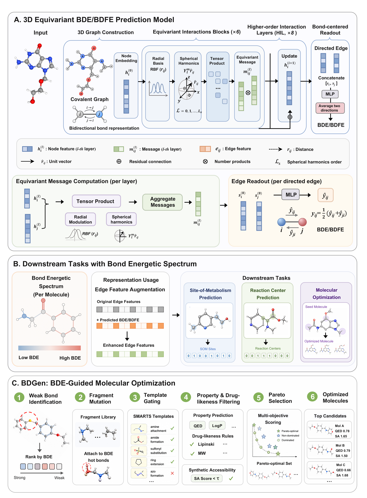

# 🧬 BDENET：Bond Energetics as a Physical Coordinate for Molecular Discovery and Design

**BDENET** is a bond-level deep learning framework for **bond dissociation energy (BDE) prediction** and **BDE-aware molecular modeling**.

The repository provides a core BDE prediction model, a BDE-guided molecular optimization module, and several downstream BDE-aware molecular modeling tools.


<p align="center">
  
</p>


---

## ✨ Overview

BDENET focuses on modeling molecular bonds from the perspective of energetic stability.

The repository contains three main parts:

| Module              | Path           | Description                                               |
| ------------------- | -------------- | --------------------------------------------------------- |
| 🧠 **BDENET**       | `BDENET/`      | Core BDE prediction model                                 |
| 🧪 **BDGen**        | [`BDGen/`](BDGen/) | Six-strategy BDE-guided molecular optimization |
| 🛠️ **Tool Models** | `tools_model/` | BDE-aware downstream models, including aweSOM and G2Retro |

---

## 🔥 Key Features

* **Bond-level BDE prediction**
* **Neural molecular representation learning**
* **BDE-guided molecular optimization**
* **BDE-aware site-of-metabolism modeling**
* **BDE-aware retrosynthesis-related modeling**
* **Multi-objective Pareto selection for molecular candidates**

---

## 📂 Repository Structure

```text
.
├── BDENET/                 # Core BDE prediction model
│   ├── bde_predictor.py
│   ├── checkpoints/
│   ├── config/
│   ├── data/
│   ├── model/
│   └── utils/
├── BDGen/                  # Self-contained six-strategy optimization package
│   ├── run_bdgen.py
│   ├── README.md
│   ├── requirements.txt
│   ├── assets/
│   ├── config/
│   ├── data/
│   └── core/
├── frag_gt/                # Standalone FragGT implementation and tests
├── tools_model/
│   ├── aweSOM/
│   └── G2Retro/
├── data/
│   ├── Extra_testset.csv
│   ├── Natural_products_testset.csv
│   ├── molecule_optimization_wetlab_pairs_15_unique.csv
│   └── overview.PNG
├── .gitattributes
├── .gitignore
├── LICENSE
├── bdenet.yml
└── README.md
```

---

# 🚀 Quick Start

## 1. Create the environment

Create the conda environment from `bdenet.yml`:

```bash
conda env create -f bdenet.yml
```

Activate the environment:

```bash
conda activate bdenet
```

---


The BDENET checkpoint is placed under:

```text
BDENET/checkpoints/BDE_ckpt_new/bde_checkpoint
```

---

# 🧠 BDENET: BDE Prediction Model

The core BDENET model is located in:

```text
BDENET/
```

The main prediction interface is:

```text
BDENET/bde_predictor.py
```

BDENET predicts bond-level BDE values for molecular bonds. The predicted values can be used to characterize bond stability, identify weak bonds, and provide BDE-aware molecular features for downstream tasks.

---

## Minimal Python Example

```python
from rdkit import Chem
from BDENET.bde_predictor import BDEPredictor

checkpoint_path = "BDENET/checkpoints/BDE_ckpt_new/bde_checkpoint"
device = "cuda:0"

predictor = BDEPredictor(
    checkpoint_path=checkpoint_path,
    device=device,
)

mol = Chem.MolFromSmiles("CCOc1ccc(CCSc2ccccc2)cc1")
bde_values = predictor.predict(mol)

print(bde_values)
```

---

# 🧪 BDGen: BDE-Guided Molecular Optimization

BDGen is distributed in [`BDGen/`](BDGen/), with a single entry point, `BDGen/run_bdgen.py`, for six optimization strategies:

* `property-only`, `bde-only`, and `joint` compare optimization objectives.
* `random`, `static`, and `dynamic` compare editing-region selection under the same joint BDE and property objective.

The package includes the inference checkpoint, BRICS fragment library, and 15 starting structures numbered MO-001 through MO-015. Dynamic editing samples from up to three distinct low-BDE regions of the current parent. All six strategies share the heavy-atom retention constraint of 70% and soft similarity guidance of 0.55. BDE objectives are evaluated over non-ring heavy-atom single bonds.

Follow the separate Linux/Python 3.12 installation instructions in the [BDGen README](BDGen/README.md). From the repository root, after activating that environment:

```bash
cd BDGen
python run_bdgen.py all --case MO-008 --profile smoke --output smoke_results --jobs 2
```

To run all 15 cases under all six strategies:

```bash
python run_bdgen.py all --output results --jobs 2
```

See the [BDGen README](BDGen/README.md) for individual strategies, effective search settings, candidate selection, output definitions, and optional post-generation ADMET evaluation. ADMET endpoints do not participate in the six-strategy optimization workflow.

---

# 🛠️ BDE-Aware Tool Models

The downstream tool models are located in:

```text
tools_model/
```

Current modules:

```text
tools_model/
├── aweSOM/
└── G2Retro/
```

## 🔥 BDE-aware aweSOM

The BDE-aware aweSOM module is used for site-of-metabolism-related modeling with additional bond-level BDE information.

## 🔄 BDE-aware G2Retro

The BDE-aware G2Retro module is used for retrosynthesis-related modeling with bond-level energetic information.

---


# ✅ BDGen Functional Check

Use the `smoke` command above to check candidate generation and selection after installation. To inspect all 90 case–strategy commands without launching molecular optimization, run:

```bash
python BDGen/run_bdgen.py all --plan-only --output planned_results
```

---

# 📄 Citation

If you use BDENET in your research, please cite:

---

# 📜 License

See [LICENSE](LICENSE) for the Apache License 2.0 terms.
